# Guía de Dockerización y Despliegue en Google Cloud Run - NohemySys

Este documento describe la arquitectura de contenedores implementada en el repositorio y la guía paso a paso para ejecutar el sistema en local con **Docker Compose** y desplegarlo en producción serverless con **Google Cloud Run** y **Cloud SQL**.

---

## 🏗️ 1. Arquitectura de Contenedores Implementada

```mermaid
flowchart TD
    subgraph Local_o_Cloud["Nube / Entorno de Ejecución"]
        subgraph Frontend_Service["Contenedor Frontend (Nginx + React)"]
            SPA["React 18 SPA (Vite Build)"]
            NGINX["Nginx Alpine (Gzip + SPA Routing)"]
        end

        subgraph Backend_Service["Contenedor Backend (Django 6 + DRF)"]
            GUNICORN["Gunicorn WSGI (3 Workers, 2 Threads)"]
            DRF["Django REST Framework + RBAC"]
            WHITENOISE["WhiteNoise (Static Files)"]
        end

        subgraph DB_Service["Capa de Datos"]
            PG["PostgreSQL 16 (Local o Cloud SQL)"]
        end
    end

    Client["Usuario / POS / Escáner Móvil"] -->|HTTP / HTTPS| NGINX
    NGINX -->|Renderiza SPA| SPA
    SPA -->|Llamadas API REST| DRF
    NGINX -.->|Proxy Inverso opcional /api| GUNICORN
    GUNICORN --> DRF
    DRF --> WHITENOISE
    DRF -->|Transacciones ACID| PG
```



### Componentes Creados en el Repositorio

| Archivo | Función |
| :--- | :--- |
| `backend/Dockerfile` | Imagen Python 3.12-slim con dependencias de PostgreSQL, Gunicorn WSGI y recolección automática de estáticos con WhiteNoise. |
| `backend/entrypoint.sh` | Script que espera a que la BD esté disponible y aplica migraciones automáticamente si `RUN_MIGRATIONS=true`. |
| `backend/.dockerignore` | Evita copiar entornos virtuales (`venv`), secretos (`.env`) y temporales a la imagen. |
| `frontend/Dockerfile` | Construcción multi-etapa (*multi-stage*): Etapa 1 compila con `node:20-alpine`; Etapa 2 sirve el bundle estático con `nginx:alpine`. |
| `frontend/nginx.conf.template` | Plantilla Nginx con compresión Gzip, enrutamiento SPA (`try_files $uri /index.html`), proxy a API y soporte dinámico de `$PORT` para Cloud Run. |
| `frontend/.dockerignore` | Excluye `node_modules` y directorios locales de la construcción de la imagen. |
| `docker-compose.yml` | Orquestador para levantar PostgreSQL 16, Backend Django y Frontend Nginx con una sola orden. |

---

## 💻 2. Ejecución Local con Docker Compose

Si deseas probar todo el stack completo en tu computadora con Docker Desktop:

1. **Instalar Docker Desktop**: Descárgalo desde [docker.com/products/docker-desktop](https://www.docker.com/products/docker-desktop) para Windows.
2. **Iniciar todos los servicios**:
   ```powershell
   docker compose up --build
   ```
3. **Acceder al sistema**:
   - Frontend (React + Nginx): `http://localhost:3000`
   - Backend API (Django + Gunicorn): `http://localhost:8000/api/`
   - Base de Datos (PostgreSQL): puerto `5432`

---

## ☁️ 3. Despliegue en Google Cloud Run (Producción)

Google Cloud Run es un entorno **serverless** donde solo pagas por el tiempo de CPU exacto cuando se reciben peticiones. Soporta escalado a cero (costo mínimo) y maneja certificados SSL HTTPS automáticamente.

### Requisitos Previos en Google Cloud
1. Cuenta en [Google Cloud Console](https://console.cloud.google.com/).
2. Crear un proyecto (ej. `nohemysys-pos`).
3. Instalar la herramienta CLI [`gcloud`](https://cloud.google.com/sdk/docs/install) en tu terminal.

---

### Paso 1: Configurar la Base de Datos (Google Cloud SQL)

1. En la consola de GCP, ve a **Cloud SQL** > **Create Instance** > **PostgreSQL**.
2. Parámetros recomendados:
   - **ID de instancia:** `nohemysys-db`
   - **Versión:** PostgreSQL 16
   - **Configuración:** `db-f1-micro` o `db-custom-1-3840` (modo económico para pruebas).
   - **Contraseña:** Genera una clave segura.
3. En la pestaña **Databases**, crea una base de datos llamada `nohemysys_db`.
4. Anota el **Instance Connection Name** (ej. `proyecto-abarrotes:us-central1:nohemysys-db`).

---

### Paso 2: Desplegar el Backend en Cloud Run

Ejecuta desde la carpeta `backend/` de tu proyecto:

```powershell
cd "c:\Users\ruben\OneDrive\Escritorio\Proyecto abarrotes\backend"

gcloud run deploy nohemysys-backend `
  --source . `
  --platform managed `
  --region us-central1 `
  --allow-unauthenticated `
  --add-cloudsql-instances <INSTANCE_CONNECTION_NAME> `
  --set-env-vars "DEBUG=False,DB_NAME=nohemysys_db,DB_USER=postgres,DB_PASSWORD=<TU_PASSWORD>,DB_HOST=/cloudsql/<INSTANCE_CONNECTION_NAME>,DB_PORT=5432,RUN_MIGRATIONS=true,SECRET_KEY=<CLAVE_SECRETA_LARGA>"
```

> [!TIP]
> Cloud Run compilará el contenedor automáticamente usando Cloud Build y te devolverá una URL segura HTTPS como:
> `https://nohemysys-backend-xxxxxx.us-central1.run.app`

---

### Paso 3: Desplegar el Frontend en Cloud Run

Una vez que tengas la URL del backend, compila y despliega el frontend inyectando esa URL:

```powershell
cd "c:\Users\ruben\OneDrive\Escritorio\Proyecto abarrotes\frontend"

gcloud run deploy nohemysys-frontend `
  --source . `
  --platform managed `
  --region us-central1 `
  --allow-unauthenticated `
  --set-env-vars "BACKEND_PROXY_URL=https://nohemysys-backend-xxxxxx.us-central1.run.app/api/"
```

> [!NOTE]
> Google Cloud Run asignará el puerto automáticamente mediante la variable de entorno `$PORT` (8080), y la plantilla Nginx que configuramos se adaptará de forma transparente.

---

## 🔒 4. Resumen de Seguridad Integrada

1. **Sin secretos en las imágenes**: Las contraseñas y claves se inyectan en tiempo de ejecución (`--set-env-vars` o Secret Manager).
2. **CORS Dinámico**: `settings.py` ya incluye la regla `r"^https://.*\.run\.app$"` para admitir los dominios generados por Cloud Run.
3. **Archivos Estáticos Blindados**: WhiteNoise almacena y sirve los recursos con hashing de contenido y caché inmutable HTTP.
